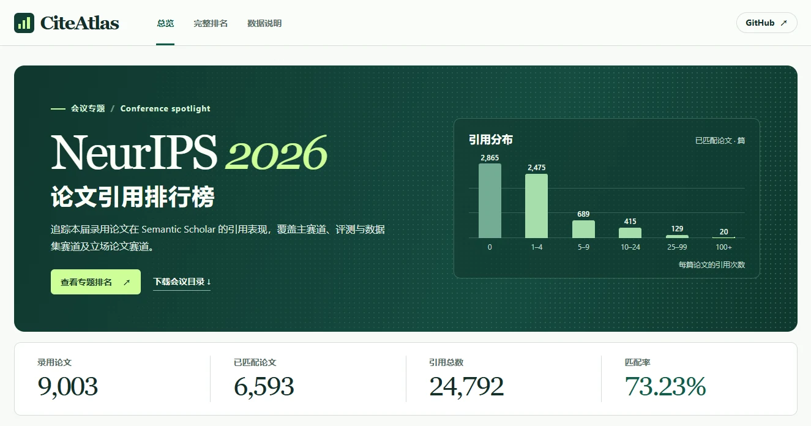

# CiteAtlas · AI 论文引用榜

CiteAtlas 按 Semantic Scholar 引用数整理 AI 会议论文。首页聚焦 NeurIPS 2026，展示引用分布、收录覆盖率和引用前五名。完整榜支持跨会议比较，可按年份、领域和论文题名筛选，也能按高影响力引用排序。

**[打开 CiteAtlas](https://yiming421.github.io/Paper-Notes/)**　·　[NeurIPS 2026 排名](https://yiming421.github.io/Paper-Notes/leaderboard/?conference=NeurIPS&year=2026)　·　[全部会议](https://yiming421.github.io/Paper-Notes/leaderboard/)

## NeurIPS 2026

会议目录覆盖主赛道、Evaluations and Datasets 和 Position 三个赛道。截至 2026 年 11 月 28 日，9,003 篇录用论文中已匹配 6,593 篇，匹配率为 73.23%，合计 24,792 次引用。首页数字随引用数据更新。

- [完整录用目录（CSV）](docs/assets/data/neurips2026.csv)收录每篇论文的会场题名、赛道和 OpenReview 编号。
- [逐篇补配明细（CSV）](docs/assets/data/neurips2026-match-audit-20261128.csv)记录 11 月 28 日复核的 2,785 篇论文及其证据。此次补入 375 篇，新增 1,259 次引用。
- [核实后的版本标识（CSV）](docs/assets/data/neurips2026-versions.csv)供后续更新重试使用。

## 排名与更新

同一作品按 Semantic Scholar 论文 ID 去重。总引用来自 `citationCount`，高影响力引用来自 `influentialCitationCount`。会议筛选采用录用年份，索引中的预印本可能更早发表。已匹配并返回零引用的论文可以入榜，未匹配条目的引用数保留为空。

现有 GitHub Actions 工作流每周刷新数据，也可在 **Actions → Update Semantic Scholar Citation Leaderboard** 手动运行。公开 API 支持无密钥访问，仓库可选用 `SEMANTIC_SCHOLAR_API_KEY` 密钥提高请求额度。生成器、缓存与例外映射见[数据维护说明](data/README.md)。

## 来源与许可

本项目 fork 自 [zhaoyang97 / Paper Notes](https://github.com/zhaoyang97/Paper-Notes)，沿用其论文笔记与分类。CiteAtlas 增加了引用匹配、NeurIPS 2026 会场目录和独立的排行榜界面。笔记原作者为 zhaoyang97，沿用 [CC BY-NC-SA 4.0](LICENSE)。会议元数据来自 [NeurIPS](https://neurips.cc/Downloads/2026)，引用数据来自 [Semantic Scholar](https://www.semanticscholar.org/)。
